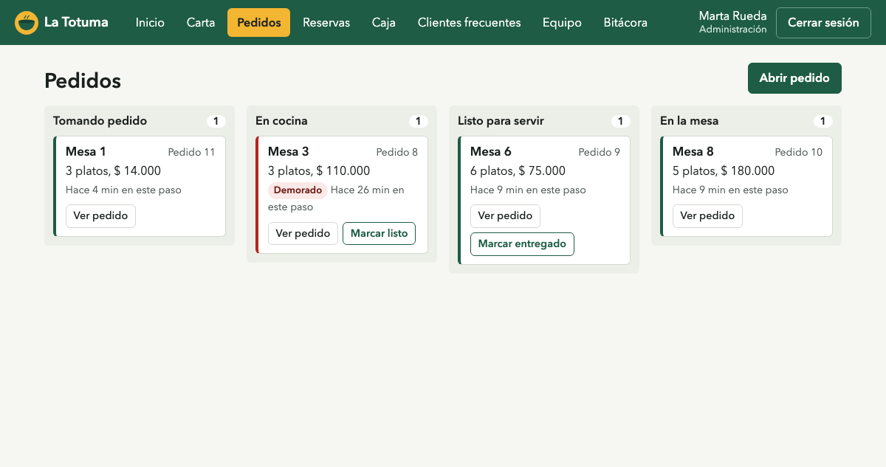

# La Totuma: Sistema Integral de Gestión de Restaurante (SIGR)

Aplicación web para administrar un restaurante de cocina santandereana: carta, pedidos, reservas, caja y un programa de clientes frecuentes que regala un postre por consumo acumulado.

Proyecto académico de la asignatura Gestión del Software (Ingeniería de Software, Tecnológica del Oriente). Se desarrolló por prototipos sucesivos, un commit por prototipo, hasta la **línea base 1.0.0**.



## Cómo ejecutarlo

No requiere instalación ni servidor.

1. Descargar o clonar el repositorio: `git clone <URL del repositorio>`
2. Abrir `index.html` en Chrome, Edge, Firefox o Safari.

Los datos se guardan en el navegador (`localStorage`). La primera vez se cargan datos de demostración. Para empezar de cero, borrar los datos del sitio desde el navegador.

## Cuentas de prueba

| Rol | Usuario | Contraseña | Qué puede hacer |
|---|---|---|---|
| Administración | `admin` | `Totuma2026*` | Todo: carta, pedidos, reservas, caja y cierre, programa de clientes, cuentas y bitácora |
| Mesero | `mesero` | `Mesero2026*` | Pedidos, reservas, cobros y canje de regalos |
| Cliente | `cliente` | `Cliente2026*` | Ver la carta, reservar y consultar su tarjeta de sellos |

Son cuentas de demostración. Cualquier persona puede crear además una cuenta de cliente desde la pantalla de acceso.

## Módulos

| Módulo | Qué hace |
|---|---|
| Acceso y roles | Inicio de sesión, registro de clientes y permisos por rol |
| Carta | Platos por categoría; administración crea, edita, elimina y marca agotados |
| Pedidos | Tablero por estados: tomando pedido, en cocina, listo y en la mesa. Alerta de demora |
| Reservas | Reserva por fecha y hora; el sistema asigna la mesa y evita cruces |
| Caja | Cobro con cálculo de cambio, ventas del día, ventas de 7 días y cierre diario |
| Clientes frecuentes | Cada $200.000 de consumo el cliente gana un postre. Tarjeta de diez sellos |
| Equipo y bitácora | Cuentas del personal y registro de quién hizo qué |

### Recorrido sugerido para probarlo

1. Entrar como `mesero`, abrir un pedido, agregar platos y asociar el teléfono `3005550101`.
2. Enviar a cocina, marcar listo y entregado, y cobrarlo en Caja.
3. Repetir hasta pasar de $200.000: el sistema avisa que la cliente ganó un postre.
4. Abrir otro pedido para ese teléfono y agregar el postre de regalo.
5. Entrar como `cliente` y ver la tarjeta de sellos en "Clientes frecuentes".
6. Entrar como `admin` y revisar Caja y Bitácora.

## Seguridad

- Contraseñas cifradas con PBKDF2-SHA256 y sal por cuenta; nunca se guardan en texto.
- Bloqueo de 5 minutos tras 5 intentos fallidos y cierre de sesión a los 15 minutos de inactividad.
- Permisos verificados en cada operación, no solo ocultando botones.
- Sin `innerHTML`: el texto de los usuarios nunca se interpreta como código.
- Política de seguridad de contenido que impide cargar scripts externos.
- Bitácora de acciones, intentos fallidos y accesos denegados.

El detalle y los límites de una aplicación sin servidor están en [docs/seguridad.md](docs/seguridad.md).

## Pruebas

59 pruebas automáticas sobre las reglas de cada módulo. Para verlas, abrir `pruebas/pruebas.html` en el navegador. Desde la terminal, en macOS con Chrome instalado:

```
python3 probar.py
```

## Documentación

| Documento | Contenido |
|---|---|
| [docs/linea-base.md](docs/linea-base.md) | Qué incluye la línea base, criterios, convenciones y proceso de cambios |
| [docs/casos-de-uso.md](docs/casos-de-uso.md) | Actores, 16 casos de uso y estados del pedido |
| [docs/diseno-ux.md](docs/diseno-ux.md) | Personas, principios de diseño, identidad visual y accesibilidad |
| [docs/seguridad.md](docs/seguridad.md) | Controles implementados y límites |
| [CHANGELOG.md](CHANGELOG.md) | Historial de versiones |

## Estructura

```
index.html            Página única de la aplicación
css/estilos.css       Estilos
img/                  Logo
js/datos.js           Almacén de datos y datos de demostración
js/seguridad.js       Contraseñas, sesión, permisos y bitácora
js/ui.js              Utilidades de interfaz
js/app.js             Arranque y navegación
js/logica/            Reglas de cada módulo, sin interfaz
js/vistas/            Una pantalla por archivo
pruebas/              Pruebas automáticas
probar.py             Ejecuta las pruebas desde la terminal
docs/                 Documentación y capturas
```

## Tecnología

HTML, CSS y JavaScript sin bibliotecas ni proceso de compilación. Se eligió así para que el proyecto se pueda abrir en cualquier equipo y no dependa de código de terceros.

## Licencia

MIT. Ver [LICENSE](LICENSE).
