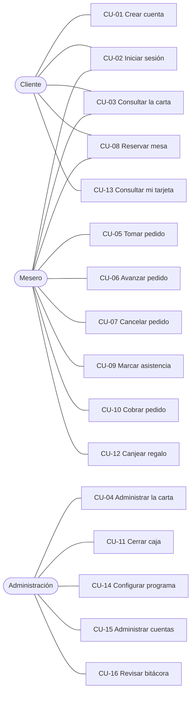
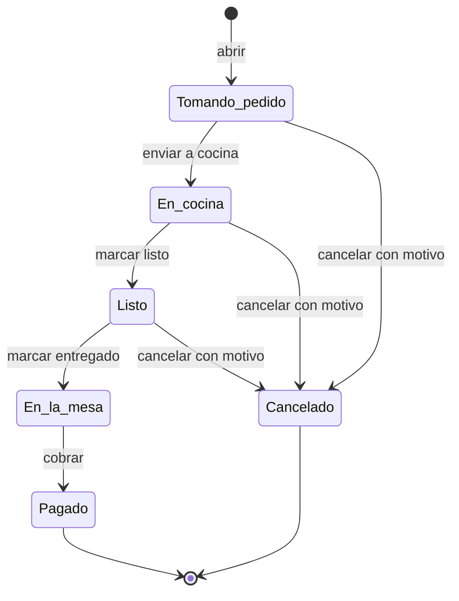

# Casos de uso

## Actores

| Actor | Quién es | Qué busca |
|---|---|---|
| Cliente | Persona que come en el restaurante y tiene cuenta | Ver la carta, reservar mesa y ganar su postre |
| Mesero | Atiende las mesas | Tomar pedidos rápido, sin errores, y cobrar |
| Administración | Dueña o encargada del restaurante | Mantener la carta, controlar la caja y saber qué pasa en el sistema |

## Diagrama general

Administración puede hacer además todo lo que hace el mesero.

## Lista de casos de uso

| Código | Caso de uso | Actor | Módulo |
|---|---|---|---|
| CU-01 | Crear cuenta de cliente | Cliente | Acceso |
| CU-02 | Iniciar y cerrar sesión | Todos | Acceso |
| CU-03 | Consultar la carta | Todos | Carta |
| CU-04 | Administrar platos y categorías | Administración | Carta |
| CU-05 | Tomar un pedido | Mesero | Pedidos |
| CU-06 | Avanzar el estado de un pedido | Mesero | Pedidos |
| CU-07 | Cancelar un pedido | Mesero | Pedidos |
| CU-08 | Reservar una mesa | Cliente, mesero | Reservas |
| CU-09 | Marcar asistencia o cancelar una reserva | Mesero, cliente (solo cancelar la propia) | Reservas |
| CU-10 | Cobrar un pedido | Mesero | Caja |
| CU-11 | Cerrar la caja del día | Administración | Caja |
| CU-12 | Canjear el postre de regalo | Mesero | Clientes frecuentes |
| CU-13 | Consultar mi tarjeta de sellos | Cliente | Clientes frecuentes |
| CU-14 | Configurar el programa de clientes frecuentes | Administración | Clientes frecuentes |
| CU-15 | Administrar cuentas del personal | Administración | Equipo |
| CU-16 | Revisar la bitácora | Administración | Bitácora |

## Casos de uso detallados

### CU-02 Iniciar sesión

- **Actor:** cualquier persona con cuenta.
- **Precondición:** la cuenta existe y está activa.
- **Flujo principal:**
  1. La persona escribe usuario y contraseña.
  2. El sistema deriva la contraseña con la sal de la cuenta y la compara con el valor guardado.
  3. El sistema abre la sesión, muestra las secciones del rol y registra el ingreso en la bitácora.
- **Flujos alternos:**
  - 2a. Los datos no coinciden: el sistema muestra "Usuario o contraseña incorrectos" (el mismo mensaje si el usuario no existe) y cuenta el intento.
  - 2b. Quinto intento fallido: la cuenta se bloquea 5 minutos y queda registrado.
  - 3a. Pasan 15 minutos sin actividad: la sesión se cierra sola.
- **Postcondición:** sesión abierta con los permisos del rol.

### CU-05 Tomar un pedido

- **Actor:** mesero.
- **Precondición:** sesión abierta; la mesa no tiene otro pedido sin pagar.
- **Flujo principal:**
  1. El mesero elige "Abrir pedido" y selecciona una mesa libre.
  2. Agrega platos indicando la cantidad. El sistema solo ofrece platos disponibles.
  3. Si el cliente es frecuente, lo asocia con su teléfono.
  4. Elige "Enviar a cocina".
- **Flujos alternos:**
  - 1a. Todas las mesas están ocupadas: el sistema lo informa.
  - 2a. El plato se agotó mientras se tomaba el pedido: el sistema lo rechaza con el nombre del plato.
  - 3a. El teléfono no corresponde a ningún cliente: el sistema lo informa y el pedido sigue sin cliente.
  - 4a. El pedido está vacío: no se puede enviar.
- **Reglas:** el pedido guarda el nombre y el precio de cada plato en ese momento; cambios posteriores de la carta no lo afectan. Después de enviarlo a cocina no se modifican los platos.
- **Postcondición:** pedido en estado "En cocina", visible en el tablero.

### CU-08 Reservar una mesa

- **Actor:** cliente o mesero.
- **Flujo principal:**
  1. La persona elige fecha y número de personas.
  2. El sistema muestra solo las horas en que hay mesa para ese grupo.
  3. La persona elige la hora. El mesero escribe además nombre y teléfono; al cliente se le toman de su cuenta.
  4. El sistema asigna la mesa más pequeña que alcance, la guarda 90 minutos y confirma.
- **Flujos alternos:**
  - 2a. No hay mesas ese día para ese grupo: se sugiere otro día o menos personas.
  - 4a. Otra persona tomó la mesa entretanto: el sistema lo informa y propone hasta cuatro horas con mesa.
  - 4b. El cliente ya tiene dos reservas vigentes: debe cancelar una.
- **Reglas:** horario de 12:00 a 20:30, cada media hora; máximo 30 días de anticipación; grupos de hasta 8 personas.
- **Postcondición:** reserva confirmada con mesa asignada.

### CU-10 Cobrar un pedido

- **Actor:** mesero.
- **Precondición:** el pedido está "En la mesa" y la caja del día no se ha cerrado.
- **Flujo principal:**
  1. El mesero abre la caja y elige "Cobrar" en la cuenta.
  2. El sistema muestra el total y el impuesto al consumo incluido.
  3. El mesero elige el medio de pago. Si es efectivo, escribe lo recibido y el sistema calcula el cambio.
  4. El sistema registra el pago, libera la mesa y suma el consumo al cliente asociado.
- **Flujos alternos:**
  - 3a. El efectivo no alcanza: el sistema lo rechaza indicando el total.
  - 4a. Con este pago el cliente completa el consumo requerido: el sistema avisa que ganó un postre.
- **Postcondición:** pedido pagado; la venta aparece en el resumen del día.

### CU-12 Canjear el postre de regalo

- **Actor:** mesero.
- **Precondición:** pedido abierto, asociado a un cliente con al menos un regalo disponible; programa activo.
- **Flujo principal:**
  1. Al abrir el pedido, el sistema muestra cuántos regalos tiene el cliente.
  2. El mesero elige "Agregar postre de regalo".
  3. El sistema agrega el postre con valor $0 y descuenta un regalo del cliente.
- **Flujos alternos:**
  - 1a. El cliente no tiene regalos: el sistema muestra cuánto le falta.
  - 2a. El postre está agotado: el regalo se conserva para otra visita.
  - 3a. El pedido se cancela: el regalo vuelve al cliente.
- **Reglas:** un regalo por pedido; el regalo no suma consumo ni cuenta como venta.

## Estados de un pedido

