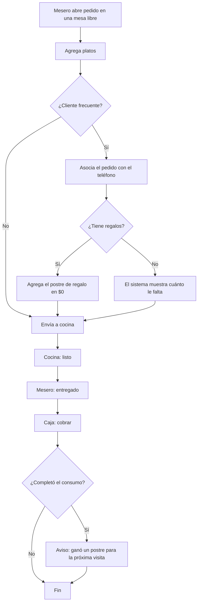

# Diseño y experiencia de usuario

## Para quién se diseñó

| Persona | Situación de uso | Lo que necesita de la pantalla |
|---|---|---|
| **Julián, mesero** | De pie, con afán, entre mesas. Usa una tableta o el computador de la barra. | Pocos toques, botones grandes, saber de un vistazo qué mesa está demorada |
| **Marta, administradora** | Al final del turno, sentada, revisando números. | Totales claros, saber quién hizo qué, no cometer errores al cerrar caja |
| **Laura, cliente** | En su celular, antes de salir de casa. | Ver la carta, reservar sin llamar y saber cuánto le falta para su postre |

## Principios

1. **Evitar el error antes que explicarlo.** El formulario de reservas solo muestra las horas que tienen mesa; el pedido solo ofrece platos disponibles; el botón de cobrar se desactiva con la caja cerrada.
2. **Un nombre para cada cosa.** El botón dice lo que hace ("Enviar a cocina", "Registrar pago") y el aviso de confirmación usa las mismas palabras.
3. **Los mensajes de error dicen qué pasó y qué hacer.** "No hay mesa para 8 a las 19:00. Horas con mesa ese día: 20:30."
4. **Las pantallas vacías orientan.** "No hay cuentas por cobrar. Aquí aparecen los pedidos cuando se entregan en la mesa."
5. **Lo irreversible pide confirmación.** Eliminar un plato, cancelar una reserva o cerrar la caja muestran una pregunta con el dato concreto.
6. **Cada rol ve solo lo suyo.** El menú se arma según los permisos; el cliente no ve secciones que no puede usar.

## Identidad visual

El restaurante es de cocina santandereana y la paleta sale de su cocina:

| Color | Valor | Uso |
|---|---|---|
| Hoja de plátano | `#1e5c45` | Barra superior, botones principales, sellos puestos |
| Maíz | `#f2b632` | Sección activa, foco del teclado, tarjeta de sellos |
| Ají | `#b3261e` | Alertas, demoras y acciones destructivas |
| Tinta | `#1b211e` | Texto |
| Hueso | `#f6f7f2` | Fondo |

- **Tipografía:** una sola familia del sistema (Avenir Next, con Segoe UI y Helvetica como respaldo). No se cargan fuentes externas, lo que además respeta la política de seguridad de contenido.
- **Números:** los valores en pesos usan cifras tabulares para que las columnas queden alineadas.
- **El color nunca va solo:** una demora se marca con el borde rojo y también con la palabra "Demorado".

## Elemento distintivo: la tarjeta de sellos

El programa de clientes frecuentes se muestra como una tarjeta de cartón con diez casillas, igual a las tarjetas de sellos de una panadería. Cada casilla vale la décima parte del consumo requerido y la última es el postre. El cliente entiende su avance sin leer cifras, y debajo tiene el valor exacto que le falta.

## Flujo principal: del pedido al postre de regalo



## Estructura de las pantallas

```
+--------------------------------------------------------------+
| La Totuma | Inicio Carta Pedidos Reservas Caja ... | Usuario |
+--------------------------------------------------------------+
| Título de la sección                        [Acción principal]|
|                                                              |
| Tablero de pedidos: una columna por estado, en el orden      |
| en que avanza el servicio                                    |
| +-----------+ +-----------+ +-----------+ +-----------+      |
| | Tomando   | | En cocina | | Listo     | | En la mesa|      |
| | Mesa 1    | | Mesa 3 !  | | Mesa 6    | | Mesa 8    |      |
| +-----------+ +-----------+ +-----------+ +-----------+      |
+--------------------------------------------------------------+
```

- La acción principal de cada pantalla está siempre arriba a la derecha.
- Los formularios largos se abren en un diálogo; los cortos van junto a la lista que modifican.
- En pantallas angostas el tablero pasa de cuatro columnas a dos y luego a una; los formularios se apilan.

## Accesibilidad

- Todo se puede usar con teclado; el foco se ve con un borde de color maíz.
- Enlace "Saltar al contenido" al inicio de cada página.
- Cada campo tiene su etiqueta visible, no solo un texto de ejemplo.
- Los errores se anuncian a los lectores de pantalla (`role="alert"`) y los avisos, sin interrumpir (`aria-live`).
- Los diálogos usan el elemento `<dialog>`, que atrapa el foco y se cierra con Escape.
- Contraste de texto por encima de 4,5:1 en todas las combinaciones de la paleta.
- La única animación es la entrada del aviso y se desactiva si el sistema pide reducir el movimiento.

## Capturas

| Pantalla | Archivo |
|---|---|
| Acceso | `capturas/01-acceso.png` |
| Carta (administración) | `capturas/02-carta.png` |
| Tablero de pedidos | `capturas/03-pedidos.png` |
| Detalle del pedido con cliente frecuente | `capturas/04-detalle-pedido.png` |
| Agenda de reservas | `capturas/05-reservas.png` |
| Caja | `capturas/06-caja.png` |
| Bitácora | `capturas/07-bitacora.png` |
| Tarjeta de sellos del cliente | `capturas/08-tarjeta-cliente.png` |
